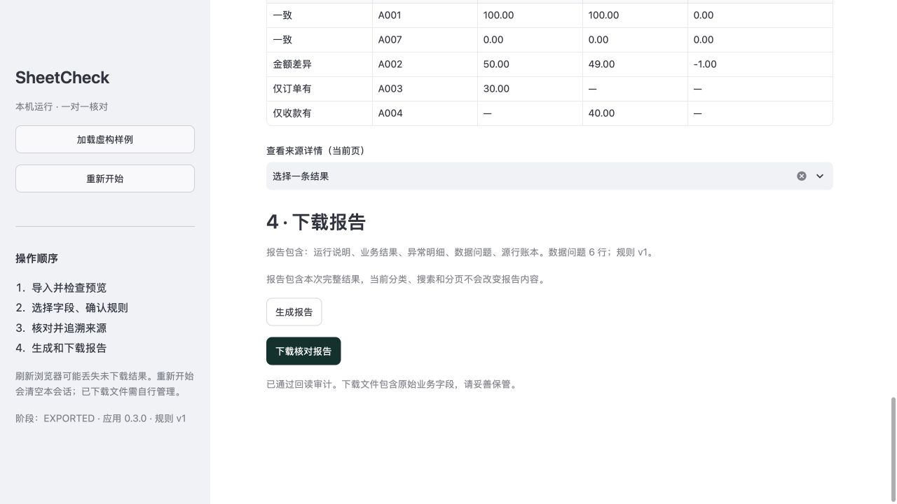

# SheetCheck

Compare order and payment exports, identify amount differences, unmatched IDs and data issues, then trace each finding to its original row. **Version 1.1.0 adds optional mapping templates; the full local suite passes 635 tests.** Templates reuse only column positions, structure and fixed rules, and require renewed confirmation. Reconciliation still uses integer minor units, a source-row ledger and mandatory safe-report auditing.

[GitHub repository](https://github.com/McGeeLee/SheetCheck) · [v1.1 verification](docs/v1.1-verification.md) · [Mapping-template guide](docs/mapping-templates.md) · [Development and CI](docs/development.md)

GitHub CI is not enabled: the current push credential lacks workflow write scope. The configuration is retained as an [inactive template](docs/ci/github-actions.yml). The 635 passing tests were run locally; no additional authorization was requested and no successful GitHub CI run is claimed.

v1.0 remains complete within its verified scope, including the user-accepted omission of the actual download from the demonstration. The [M4 acceptance record](docs/m4-verification.md), earlier successful download and native Excel observations remain historical evidence. v1.1 does not retry recording permissions or relabel historical performance/native-software observations as new runs. Compatibility claims remain bounded by actual evidence.

The project is independent of other projects in its parent directory, including Sirius. The core does not import Streamlit and remains callable through Python or the CLI. No account, database, API key or external business service is required. All bundled samples are fictional. Reconciliation differences are observations, not conclusions about debts, fraud or accounting errors.

## Install and run

Installed and checked on macOS 27.0.1, Apple arm64, CPython 3.12.14, with Streamlit 1.66.0. `requirements.lock` pins 43 runtime, test and build packages with exact wheel hashes. Native wheels target macOS arm64; another OS or architecture needs a separately generated and tested lock. Use Python 3.12 and run from this directory:

```sh
python3.12 -m venv .venv
.venv/bin/python -m pip install --require-hashes -r requirements.lock
.venv/bin/python -m pip install --no-build-isolation --no-deps -e '.[ui,test]'
.venv/bin/python -m pip check
.venv/bin/python -m pytest -q
.venv/bin/python -m streamlit run app.py --server.address 127.0.0.1
```

Open `http://127.0.0.1:8501`; stop the server with Ctrl+C in its terminal. Run from the project directory so `.streamlit/config.toml` is loaded. Keep the server on `127.0.0.1`; do not bind to `0.0.0.0` or deploy remotely. Streamlit uploads go to the machine running the server. The local-processing description applies only to the local loopback setup.

The initial dependency acquisition needs a network connection or a prebuilt, trusted wheelhouse matching the lock hashes. M4 first created `.venv-m4-clean` and checked all 43 wheel hashes, metadata and platform tags. Final 1.0.0 passed **502 tests in 27.40 seconds** in that environment. The earlier temporary wheelhouse `/private/tmp/sheetcheck-m3-wheels` later no longer existed, so all 43 locked wheels were downloaded again into `outputs/m4/wheelhouse`. A new `.venv-m4-release` then installed offline with `--no-index --require-hashes`; `pip check`, versions and effective configuration passed, followed by **502 tests in 33.88 seconds**. These are two runs of the same suite, not 1004 distinct tests.

See [final installation and delivery](docs/m4-delivery.md), the [wheelhouse refresh record](docs/m4-wheelhouse-refresh.json), [release environment inventory](docs/m4-release-environment.json), [clean test output](docs/m4-test-results.txt) and [release test output](docs/m4-release-test-results.txt). Online dependency preparation, offline installation and the externally blocked business workflow are recorded separately; the entire delivery process was not network-free. Earlier 0.3.0 evidence retains its measured version and is not relabelled as a 1.0.0 rerun. The dependency versions are not claimed to be the latest.

`python3.12` must already exist on your PATH, or be replaced with a verified Python 3.12 executable path. The system Python 3.9 is unsupported. Reproduction instructions and preparing an offline wheelhouse are in the delivery guide.

For a reproducible CLI sample without starting the page:

```sh
.venv/bin/python -m sheetcheck --demo
```

## Page workflow

1. Select **加载虚构样例** (load fictional sample). Inspect the order and payment inputs. Each preview contains at most 20 source records, preserving text IDs and source positions. Long preview fields are explicitly marked as shortened for display.
2. Check each ID and amount mapping. Options include the column number and original header, so empty or duplicate headers remain distinguishable. The same column cannot serve as both ID and amount. For your own XLSX, select the worksheet and header row; CSV also supports encoding, delimiter and logical header-record selection.
3. Select the currency, enter the period and confirm both matching currency and matching period. Even the sample requires explicit confirmation. Click **开始核对** (reconcile). The program cannot establish the real business coverage of your inputs.
4. Inspect totals, then switch among all business results, amount mismatches, order-only, payment-only and data issues. Search uses case-sensitive ID substring matching. Business results also have status filters. Results are paginated on the server, at most 100 per page; changing a category, search or filter returns to page one.
5. Choose an item under **查看来源详情（当前页）** (source details for the current page). Inspect both sides' file, worksheet, original row, CSV physical span, mapping columns and raw values. Expanded details include source/result IDs, SHA-256, raw types and repair suggestions.
6. Click **生成报告** (generate report), wait for export and mandatory readback auditing, then **下载核对报告** (download report). The report always contains the complete current run; category, search and pagination do not trim it.

Replacing or removing either file, or changing the worksheet, header, encoding, delimiter, mapping, currency, period or either confirmation invalidates the old result and report. Run reconciliation and report generation again using the new choices. Late work from an older input version cannot replace the current state. Files already received or saved by the browser cannot be revoked.

**重新开始** (start again) clears all current-session input selections, sample data, mappings, confirmations, filters, pagination, results and report references. Refreshing the browser may lose undownloaded work. Reset releases references; it does not securely erase RAM, swap or downloaded files. The [Chinese workflow and recovery guide](docs/m3-workflow.md) describes common import and export failures.

Inputs, parsed tables, results and pending report bytes remain in the current session's memory by default. There is no cross-session upload cache or automatic project-directory output. A page report is saved through the browser only when the user downloads it. Usage statistics and the table widget's generic CSV export are disabled. CORS/XSRF remain enabled; the page uses system fonts and no third-party components or remote fonts. M4 separately completed an application-scoped workflow using an OS loopback-only policy for the service and a browser-page CSP, including actual upload, mapping, reconciliation, download and independent readback. The whole Mac was not physically disconnected and no full pcap was captured. Normal application startup does not automatically apply the acceptance fixture's network policy. See [network acceptance and its scope](docs/m4-offline.md).

## Reuse a field-mapping template

Enable **使用映射模板（可选）** in the rules area. After choosing both mappings, **保存当前映射模板** exports a small JSON configuration. On new inputs, select the files, worksheets and parsing settings first, upload the JSON, then explicitly choose **应用到当前两份文件**. Uploading a template alone does not change the current choices.

Templates contain no filenames, worksheet/header text, IDs, amounts, period or confirmation flags. Both source structures must match before application. Applying even the same mapping revokes the previous result/report and clears the period and confirmations. Equal column counts cannot establish unchanged column meaning or order: inspect previews and mapping examples before confirming. See the [template guide](docs/mapping-templates.md).

## Safe Excel reports and CLI

To explicitly save a fictional report into an existing directory:

```sh
mkdir -p reports
.venv/bin/python -m sheetcheck --demo --export-dir reports
```

The generated name is `sheetcheck_UTCtimestamp_runid.xlsx`. Existing files and symlinks are never overwritten. Export or save failures return exit code 2 without success JSON; Ctrl+C returns 130. Successful export diagnostics on stderr contain only `code=EXPORTED stage=EXPORT version=...`, not the full filename. Application error diagnostics do not echo IDs, amounts, raw rows or paths; requested business JSON, previews and reports retain source values by design. Canary and failure-path checks are recorded in [logging and security acceptance](docs/m4-log-security.md). Without `--export-dir`, the CLI writes JSON only to stdout. Shell redirection explicitly saves that JSON. Core/report APIs use memory, including worksheet serialization, without disk temporary files.

`export_xlsx(result) -> bytes` checks kernel invariants, writes an in-memory workbook, scans its ZIP/XML package and verifies saved values and types before returning. `audit_xlsx(bytes, result)` performs another readback when needed. The API accepts bytes rather than arbitrary file paths; source files are unchanged. Reports contain mapped business values and must be handled accordingly.

The five fixed worksheets are Run information (`运行说明`), Business results (`业务结果`), Exceptions (`异常明细`), Data issues (`数据问题`) and Source ledger (`源行账本`). They include versions, rules, hashes, mappings, input scope, counts, totals and coverage warnings. Source IDs join results to ledger entries and exact source positions. Every source row has one ledger entry, including skipped empty rows; repeated references across worksheets must not be counted twice.

All user text is explicitly typed as text. Dangerous prefixes, unsafe controls, reserved-prefix collisions and original empty strings use reversible `SC_ESC:` + JSON-string encoding; in-memory source values remain unchanged. Decode exactly once with `sheetcheck.report.decode_text`. Missing counterparts remain blank; true zero is `0` minor units and `0.00` display text. Money has two-decimal display strings alongside integer minor units. Aggregate integers of 16 or more digits are exact text with an explanation, avoiding Excel numeric precision loss. No formulas, hyperlinks, external links or macros are emitted. Only the five exact static filter ranges are permitted as defined names. See the [report contract](docs/m2-report-contract.md) and historical [M2 verification](docs/m2-verification.md).

## Rules and independent sample answer

The hand-written oracle is `samples/expected.json`; M1 and M2 actual output files remain historical evidence. The canonical sample has 2 exact pairs, 1 mismatch (-100 minor units), 1 order-only result, 1 payment-only result, 6 quarantined rows and 14 ledger entries. Eligible order/payment totals are 18000/18900 minor units. Parseable issue subtotals are 3500/4200; one order issue has an unparseable amount.

IDs are case-sensitive text, preserving leading zeros and literal NA/NULL. There is no trimming, normalization or fuzzy matching. Duplicate IDs or any associated error quarantine the same exact ID on both sides. Unknown IDs produce a coverage warning. Amounts use Decimal from strings then integer minor units, without rounding. Negative amounts, scientific notation, currency symbols and more than two decimal places are rejected. Tolerance is zero; maximum amount is 999999999.99. Supported currencies are CNY, USD, EUR, GBP, HKD, SGD, AUD, CAD, NZD and CHF; there is no conversion.

CSV provenance includes logical record number and physical line span. XLSX provenance retains worksheet, row, raw cell types and hidden-row status. Formulas or merged regions intersecting mapped fields or headers block the run; cached formulas are never used. Missing counterparts and their differences remain null. Input limits: 10 MiB/file, 50000 data records, 100 columns, 100 MiB expanded XLSX, 2000 ZIP members, 200:1 compression ratio, XML depth 128 and CSV fields up to 131072 characters. Unsupported, damaged, encrypted, externally linked and active-content files are rejected. Complete rules are in [rules-v1](docs/rules-v1.md).

## M4 acceptance scope and performance

| Item | Completed evidence and scope |
| --- | --- |
| Clean installation | macOS 27.0.1 / Apple arm64 / CPython 3.12.14; 43 locked dependencies installed offline in a fresh environment and checked. 1.0.0 passed the same 502-test suite in each of two environments; see the [delivery record](docs/m4-delivery.md) |
| Application-scoped external-network isolation | OS loopback restriction for the service, CSP for page resources, IPv4/IPv6 rejection controls, browser image-blocking control and an actual upload-to-download workflow. This is not physical disconnection or proof about all system traffic; see [network evidence](docs/m4-offline.md) |
| Logging and report safety | Fixed diagnostics, canary redaction, unexpected and deferred-download exception wrapping, in-memory workflow, formula-injection and damaged-file regression; see [security evidence](docs/m4-log-security.md) |
| Default capacity boundaries | All 20 actual-threshold cases behaved as expected: CSV/XLSX 10 MiB, 50k records and 100 columns; XLSX 100 MiB expanded, 2000 ZIP members, 200:1 compression and XML depth 128. Independent dimensions do not prove every maximum-size combination |
| Native Excel | Excel for Mac **16.114 (16.114.26101123)** opened one synthetic mixed-input report generated by 0.3.0. Checks included A002 difference, A007 zero versus missing values, A005 isolation and source rows. No editing or saving; hash unchanged. Scope is that Excel version and that report only; see [Excel record](docs/m4-excel.json) |

Benchmarks used an Apple M4 with 10 logical CPUs and 24 GiB RAM. Each side had two columns of synthetic mixed data; each trial ran in a fresh process. Reading, core work, export including mandatory readback, and an extra readback were timed separately. RSS is the child process's cumulative high-water mark, excluding the browser and page server.

- Before the workbook-release fix, CSV 10k per side completed three trials with core median **0.761 seconds** and maximum peak **405.17 MiB**, meeting both suggested targets in all trials. XLSX core times were **3.094 / 2.621 / 1.153 seconds**, maximum peak **413.20 MiB**; the first core result missed the suggested 3-second target and remains in the original evidence.
- The writer workbook was retained by local worksheet references and cycles. The fix scopes writing separately and collects unreachable objects before running the unchanged mandatory audit. The first post-fix 0.3.0 XLSX 10k trial measured core **0.266 seconds** and peak **429.59 MiB**; that historical result is retained separately.
- Final **1.0.0** completed three sequential XLSX 10k trials in `.venv-m4-release`: core **0.247 / 0.254 / 0.251 seconds**, maximum peak **430.00 MiB**, meeting the suggested 3-second / 512-MiB targets in all three. Median reading was **0.677 seconds**, export with readback **15.550 seconds**, and extra readback **6.682 seconds**.
- Final **1.0.0 XLSX 50k per side** completed a full trial: reading **3.505 seconds**, core **1.473 seconds**, export with readback **85.946 seconds**, extra readback **35.170 seconds**, peak **1951.33 MiB**. All 35k business records, 100k ledger rows and both readbacks passed; the 900-second timeout was not reached. The 10k suggested 512-MiB target does not apply to 50k.
- Pre-fix CSV 50k observations remain **8.605 / 411.069 / 129.506 seconds** (core / export with readback / extra readback) and **1681.39 MiB**. The earlier XLSX 50k cancellation for the lifecycle fix is also retained. Neither is relabelled as a final-version result; the new successful final XLSX 50k trial has its own record.

Final CPU/wall-clock measurements continue to locate most work in export and readback. Different dates, input formats and desktop loads are not a controlled A/B experiment: timing differences cannot all be attributed to the fix, and no general reduction in peak RSS is established. **All three final 10k trials meet the targets; this does not mean every historical performance observation passed.** The original 3.094-second miss remains recorded. Commands, trial data, analysis, historical cancellation and final reruns are in [capacity and performance acceptance](docs/m4-capacity.md), [final 10k data](docs/m4-benchmark-xlsx-10k-final.json) and [final 50k data](docs/m4-benchmark-xlsx-50k-final.json).

## Demo and delivery

This actual page screenshot comes from M4's scoped network-isolation workflow on the 0.3.0 development snapshot. Its report was actually downloaded, independently recomputed and checked with `audit_xlsx`:



[Watch the two-minute demo](outputs/m4/sheetcheck-demo.mp4) · [Captions](outputs/m4/sheetcheck-demo.vtt) · [Video validation](docs/m4-video-verification.json)

The finished video is **120.600 seconds, 1024×960, H.264 / yuv420p, with no audio track**. Full decoding and visual checks of seven keyframes passed. Six chronological clips of genuine page screenshots are joined with explicit cuts, preserving timing inside each clip. The 10-fps output duplicates captured screenshots; it is not a continuous 10-fps screen recording, and its edited duration is not a performance measurement. MP4 SHA-256: `294470181cfca5a588c5b8afcda2b9881b583711a286167e937f787cf031ccac`.

On 2026-10-24 (Asia/Singapore), the user explicitly waived a new download recording, accepted the earlier successful-download evidence with its limits documented, and authorized completing v1 within the verified scope. This accepted recording limitation is no longer a completion blocker; no further download-permission prompts are required.

The video shows application 1.0.0 loading the fictional sample, mapping fields, inspecting A002 and A005, tracing source rows, generating an audited report and displaying the download entry point. Earlier automation attempts repeatedly triggered download-approval loops, so the final recording did not click download; the caption states this explicitly. This recording limitation does not establish a product download failure. The earlier **0.3.0** real mixed-input UI download, independent recomputation/readback and Excel for Mac check are separate [network/download evidence](docs/m4-offline.md), not depicted as a new download in this video. The final 1.0.0 CLI sample was also independently checked; see the final acceptance record.

[Package access, rebuilding and reproduction guide](docs/m4-delivery.md) · [M4 verification](docs/m4-verification.md) · [Changelog](CHANGELOG.md) · [Machine-readable delivery status](docs/m4-release-status.json)

The delivery guide covers installation, startup, shutdown, samples, offline dependencies and evidence. Historical [M3 page verification](docs/m3-verification.md), M2 and M0–M1 records retain their own versions and test counts; overlapping targeted counts must not be added to the final full-suite count.

## Compatibility boundaries and untested areas

Windows, Linux, Intel Mac, other Python versions, Windows Excel, WPS and LibreOffice were not tested. There is no all-platform compatibility claim. Maximum fields, wide tables, shared strings, styles and concurrent-session combinations have not all been stress-tested. Synthetic 10k benchmarks and independent 100-MiB XML boundary checks do not establish universal 512-MiB process bounds. Some otherwise valid workbooks with external hyperlinks or active content are intentionally rejected; export ordinary value tables from a trusted source.

Escaped report fields exceeding 32767 UTF-16 code units fail without truncation; some long CSV fields accepted by the reader therefore cannot be exported. Report ZIP/expanded XML limits are 128/512 MiB, not process-memory guarantees. The memory-only writer uses pinned openpyxl 3.1.5 internals and must be retested before upgrades. There is no automatic wall-clock timeout.
