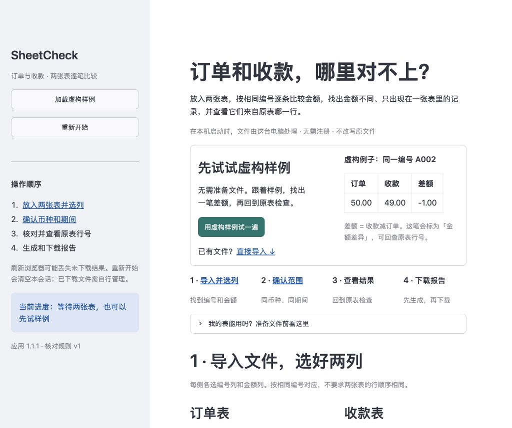

# v1.1.1 页面与新手引导验证

日期：2026-10-24。目标是让第一次打开的人知道 SheetCheck 用来比较什么，以及每一步怎样继续。核对规则 `v1`、报告格式 `m2-v1`、依赖锁与容量限制均未改变。

## 页面变化

- 首屏直接解释订单与收款的比较，用虚构 A002 的 50.00 / 49.00 / -1.00 展示差额；主区提供“用虚构样例试一遍”和导入入口。
- 四步概览对应导入选列、确认范围、查看结果、下载报告。选列处解释编号与金额的含义；CSV 编码、分隔符、表头与可选模板收进折叠区，当前读取方式仍可见。
- 按当前输入显示具体待办，区分缺少文件、读取失败、未选字段和未确认。样例不自动勾选确认；替换任一文件后不再显示完整虚构样例提示。
- 结果给出下一步和快捷入口。快捷查看会清空搜索、恢复状态筛选、回到第一页并清除来源选择，但不改变核对结果或报告。
- 无可核对记录时提示检查输入范围。报告就绪明确表示“下一步下载”，不把生成成功说成已经保存。重置恢复首次使用入口。



操作说明见 [第一次使用 SheetCheck](getting-started.md)。M3、M4 与 v1.1.0 的验收文件保留为历史记录，不用新文案改写过去的测试结果。

## 本地验证

使用原有 `.venv-v1.1`，通过 `--no-index --no-build-isolation --no-deps` 更新本地可编辑应用到 1.1.1，没有新建干净环境。43 个锁定 wheel 的哈希、已安装版本、`pip check`、实际配置和最终源码快照由 [环境清单](v1.1.1-environment.json) 记录。

最终命令：

```sh
.venv-v1.1/bin/python -m pytest -q
.venv-v1.1/bin/python scripts/verify_install.py --wheelhouse outputs/m4/wheelhouse --output docs/v1.1.1-environment.json
```

完整回归 **645 passed in 36.93s**，见 [原始输出](v1.1.1-test-results.txt)。这是原有 635 项加 10 项新手引导回归；定向运行不重复计数。新增测试覆盖主区样例入口、手动确认、部分导入、读取失败、结果快捷筛选、205 条结果的分页与来源清理、只有表头的空输入、换输入和重置。既有报告生成、安全回读、模板、异常日志与失效测试也在完整套件中通过。

实际本机浏览器在 1024 × 858 窗口完成首屏、样例、确认、核对、数据问题、金额差异、A002 双侧原表第 3 行追溯、报告生成和重置。记录见 [浏览器检查](v1.1.1-browser-check.json) 和 [报告就绪截图](v1.1.1-report-ready.png)。没有点击下载按钮，没有执行浏览器文件上传或补录下载录像；AppTest 的上传/下载事件不被当作真实浏览器文件传输证据。

## 交付与边界

- 用户要求 GitHub 自动测试暂不启用，仓库没有活动工作流；[配置模板](ci/github-actions.yml) 继续放在 `docs/ci/`。没有新增权限申请，也没有远程 CI 通过声明。
- [v1.0 收尾记录](m4-closeout.json) 固定的 16 份证据均通过哈希复核，包含此前成功下载和原生 Excel 的观察。其版本和限制保持原样。
- 本次没有重跑全套容量、性能、应用断外网或原生 Excel 验收，没有扩大跨平台、手机或浏览器兼容声明。环境与历史范围分别见 [v1.1 验证](v1.1-verification.md) 与 [M4 总验收](m4-verification.md)。
- `scripts/build_delivery.py` 为 1.1.1 使用独立清单和回执，生成本地 `deliveries/SheetCheck-1.1.1.zip`；不覆盖旧版本包。CRC、成员集合、逐文件哈希与解压检查见 [包校验回执](v1.1.1-package-verification.json)。包和依赖 wheel 不提交 Git。

完成状态见 [状态记录](v1.1.1-release-status.json)。
