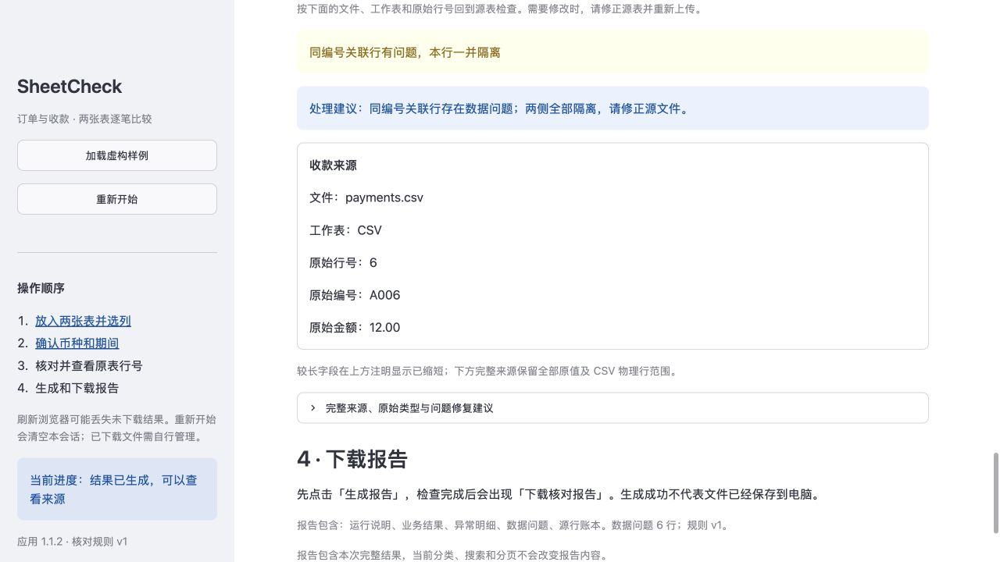

# v1.1.2 问题解释与页面恢复验证

日期：2026-10-26（Asia/Singapore）。本轮改善看懂数据问题、找到原始记录和恢复筛选的操作。核对规则 `v1`、报告格式 `m2-v1`、依赖锁与容量限制均未改变。

## 页面变化

- 数据问题先展示中文说明和处理建议，保留全部问题码、原始金额和原始行号。例如，A006 的收款金额虽然是有效的 `12.00`，仍因同编号订单有问题而一并隔离。
- 来源详情以卡片显示文件、工作表、原始行号、原始编号和原始金额。业务结果并列显示两侧来源；缺少配对的一侧明确说明缺失，不显示成零。完整字段、CSV 物理行范围、类型和问题码继续保留在折叠区。
- “清空筛选”恢复全部业务结果、清空搜索、恢复全部业务状态并回到第一页。“上一页 / 下一页”在边界禁用；翻页会清除上一页的来源选择。筛选和翻页不重新核对、不改变报告。
- Excel 只有一张工作表时自动选中并固定选择；有多张工作表（包括隐藏工作表）时需要手动选择。尚未选择时显示下一步引导，不提前显示读取失败。



使用步骤见 [第一次使用 SheetCheck](getting-started.md)。

## 本地验证

复用 `.venv-v1.1`，使用 `--no-index --no-cache-dir --no-build-isolation --no-deps` 更新可编辑应用到 1.1.2，没有新建干净环境。检查环境为 **macOS 27.0.1 arm64 / CPython 3.12.14**；43 个锁定 wheel 的哈希、已安装版本、`pip check`、实际配置和 51 个源码文件的快照检查通过，见 [环境记录](v1.1.2-environment.json)。

```sh
.venv-v1.1/bin/python -m pytest -q
.venv-v1.1/bin/python scripts/verify_install.py --wheelhouse outputs/m4/wheelhouse --output docs/v1.1.2-environment.json
```

最终完整回归 **677 passed in 39.09s**，见 [原始输出](v1.1.2-test-results.txt)。原有 645 项加 20 项问题展示测试、12 项页面恢复测试；定向运行不重复计数。

- 问题展示测试覆盖全部 12 个问题码、多个问题的顺序与去重、未知问题回退、原字段保留及危险字符串不进入固定说明。
- Streamlit AppTest 覆盖单工作表、多个及隐藏工作表、同名文件替换、清空筛选、205 条记录的三页边界、空结果、来源选择清理、报告保持、换输入失效和重置。上传由 AppTest 提供内存虚构文件，不当作浏览器文件上传证据。
- 既有核对、导出、安全回读、状态失效和日志脱敏测试均包含在最终完整套件中。

第一次完整运行是 **1 failed, 676 passed**，保留在 [初次输出](v1.1.2-test-initial.txt)。失败来自新增测试错误地把 `BLOCKED_ID` 当作只出现在一条样例记录上的问题码；原样例有 5 条关联隔离记录。测试改为精确选择 A006 收款行后检查其原值与问题码，没有修改内核、隔离规则或样例期望。该次运行期间测试文件已被修正，因此初次失败输出显示的源码行与当时已加载执行的旧筛选条件不同；原始输出未改写。文件冻结后重新运行上述完整套件通过，最终源码哈希见环境记录。

## 实际浏览器观察

本机内置浏览器在 **1280 × 720** 窗口完成首次入口、加载虚构样例、手动确认、核对、查看数据问题、A006 收款源行 6 的说明与来源卡片、生成报告并通过回读。搜索 `NO-SUCH-ID` 得到 0 条后，点击“清空筛选”恢复 5 条业务结果、第一页，已生成报告保持可用；“重新开始”回到首次入口，下载按钮和报告就绪提示消失，核对按钮禁用。详见 [浏览器检查](v1.1.2-browser-check.json)。

浏览器只检查样例的单页边界，205 条翻页和多工作表选择由 AppTest 覆盖。本轮没有真实浏览器文件上传、点击报告下载或补录下载录像。

## 交付与边界

- 用户要求 GitHub 自动测试暂不启用；[工作流模板](ci/github-actions.yml) 继续放在 `docs/ci/`，没有活动 `.github/workflows`，不声明远程 CI 通过。
- [v1.0 收尾记录](m4-closeout.json) 固定的 16 份历史证据已逐个复核哈希，保持不变。此前成功下载、原生 Excel 和其他验收的版本与限制仍按原记录区分。
- 本轮没有重跑干净安装、全量容量、性能、应用断外网或原生 Excel 验收，没有扩大 Windows、Linux、Intel Mac、手机或其他浏览器兼容范围。历史验收见 [M4](m4-verification.md)、[v1.1](v1.1-verification.md) 与 [v1.1.1](v1.1.1-verification.md)。
- 本地交付包为 `deliveries/SheetCheck-1.1.2.zip`，包含当前源码、文档、虚构样例、历史验收材料及本机依赖 wheel。版本独立，不覆盖旧包；CRC、成员集合、逐文件哈希和解压检查见 [包校验回执](v1.1.2-package-verification.json)。解压内容未再次运行应用测试，包校验只证明完整性。交付包和 wheel 不提交 Git。

完成状态见 [状态记录](v1.1.2-release-status.json)。
