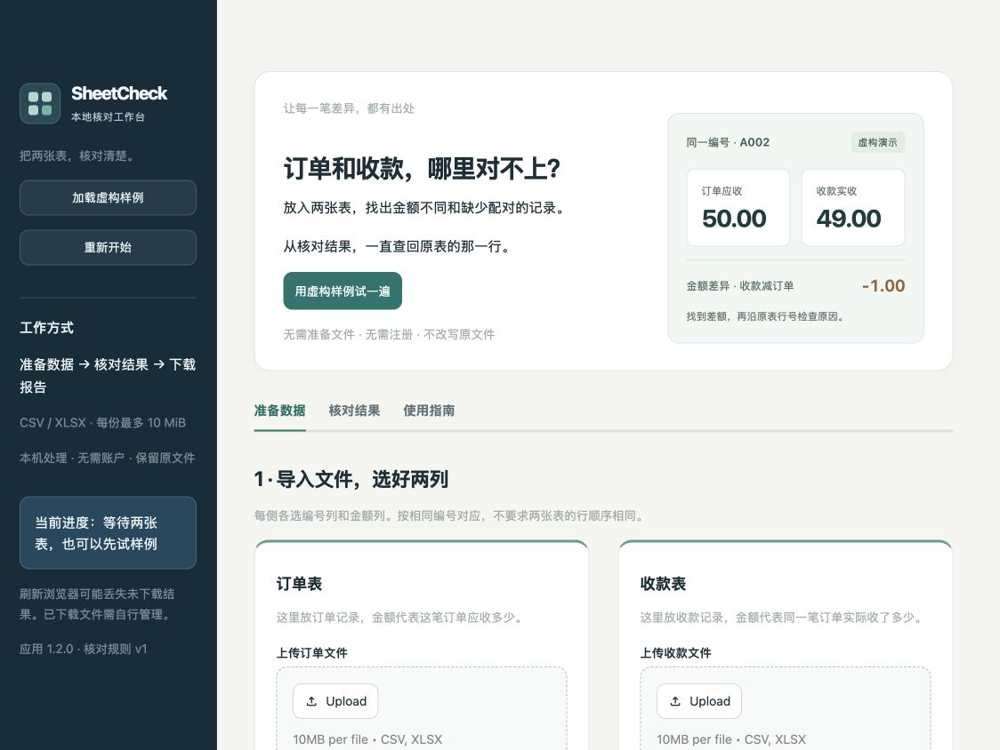
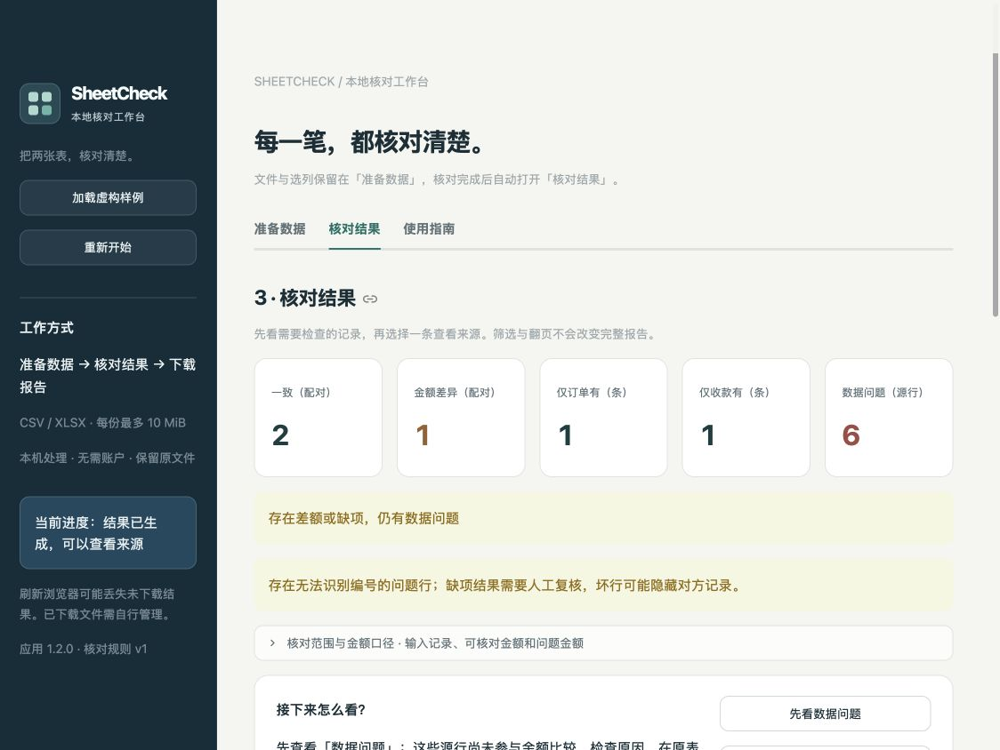

# v1.2.0 工作台界面与导航验证

日期：2026-10-26（Asia/Singapore）。本轮将单页长表单整理为本地核对工作台，改进视觉层次、工作区导航与内容密度。核对规则 `v1`、报告格式 `m2-v1`、输入限制、依赖锁和安全配置没有改变。

## 可见变化

- 深色侧栏、浅色画布、白色卡片、统一间距和青绿色主操作。首页用虚构 A002 的订单 / 收款 / 差额示意说明用途，并提供样例入口。
- “准备数据 / 核对结果 / 使用指南”分开呈现。成功核对后自动选择结果工作区；原文件和映射仍保留，切换工作区不重新核对。
- 两侧文件分别放进完整卡片。已导入文件的上传控件收进“更换文件”；读取选项和前 20 条预览可展开查看，编号与金额选列并排。
- 结果首先展示五种主要状态，输入记录数、可核对金额、问题金额和空行数放入“核对范围与金额口径”。业务警告保持可见，不与普通说明一起折叠。
- 独立报告卡说明五张工作表及完整报告范围，继续区分“生成并回读通过”和“已下载保存”。





指南见 [第一次使用](getting-started.md)。样式和示意图来自本地静态 CSS / HTML，没有 JavaScript、远程字体或图像。文件名、工作表、编号、金额等原始业务字段不拼进装饰 HTML，继续由原有文本、表格和转义后的控件标签展示。

## 状态与回归测试

三个标签页的内容在每次运行时都创建，没有按可见性省略控件，避免切换时被 Streamlit 清理已有值。导航请求在创建标签页之前应用；核对成功、输入修改和模板应用后的重跑不会跳过输入同步、校验或失效处理。

完整回归命令：

```sh
.venv-v1.1/bin/python -m pytest -q
.venv-v1.1/bin/python scripts/verify_install.py --wheelhouse outputs/m4/wheelhouse --output docs/v1.2-environment.json
```

最终完整套件 **684 passed in 40.86s**，见 [原始输出](v1.2-test-results.txt)。原有 677 项加 7 项工作区状态测试，定向运行不重复计数。新增测试验证初始空态、手动确认保留、成功核对自动进入结果、切换工作区保留筛选 / 来源 / 报告、改规则与换文件撤销旧报告、重置撤销延迟下载。

Streamlit 1.66 的 AppTest 没有标签页点击方法；新增测试通过标签页实际使用的会话状态值驱动应用重跑，再检查真实控件和工作流对象。标签页真实点击另由下述浏览器观察验证。已有 Excel 工作表、模板、安全报告回读、分页、日志和输入失效测试仍包含在完整套件内。

复用 `.venv-v1.1`，以 `--no-index --no-cache-dir --no-build-isolation --no-deps` 更新可编辑应用到 1.2.0，没有新建干净环境。环境检查通过 43 个锁定 wheel 哈希、已安装版本、`pip check`、实际本地配置与 53 个源码文件的快照，见 [环境记录](v1.2-environment.json)。环境范围仍为 **macOS 27.0.1 arm64 / CPython 3.12.14**。

## 实际页面检查

在 Codex 内置浏览器 **1124 × 844** 窗口检查最终页面：

- 首次入口、未核对结果空态、使用指南、加载虚构样例与准备工作区。
- 样例确认项初始未勾选；手动确认后核对，结果标签自动选中，显示一致 2 对、金额差异 1 对、单侧各 1 条、数据问题 6 源行。
- 金额差异筛选只显示 A002；来源卡片显示 orders.csv / payments.csv 的第 3 行，原始金额分别 50.00 / 49.00。
- 生成报告并通过内置回读，显示下载按钮；切到指南再回来仍保留 A002 筛选、来源选择和已生成报告。回准备工作区，原选列和确认项仍在。
- 修改核对期间后，旧结果和报告失效；结果工作区恢复空态。从指南点击“重新开始”，恢复首次入口、准备工作区和禁用的核对按钮。
- 开发中发现并修正了指标标题截断及顶部文字遮挡，最终截图中的五种指标名称可读。样例预览展开也已观察。自动切换标签不承诺将页面滚动到顶部，长内容仍需滚动。

见 [浏览器记录](v1.2-browser-check.json) 与 [报告就绪截图](v1.2-report-ready.png)。没有点击报告下载，没有浏览器文件上传或补录下载录像。文件替换、多工作表、205 条翻页等由本地测试覆盖，不作为本轮浏览器文件传输或多页实测声明。

## 交付范围

- GitHub 自动测试继续按用户要求不启用，`docs/ci/github-actions.yml` 仍是非活动模板，没有新增 `.github/workflows` 文件，也不声明远程 CI 通过。
- [M4 收尾](m4-closeout.json) 固定的 16 份历史证据已复核哈希，保持不变。旧版成功下载、原生 Excel 和性能等结果仍按原版本与范围区分。
- 没有重跑干净安装、全量容量 / 性能、断外网、原生 Excel 验收；没有扩大手机、其他浏览器、Windows、Linux 或 Intel Mac 的兼容声明。样式含窄屏布局规则，但本轮没有手机设备验收。
- 本地包 `deliveries/SheetCheck-1.2.0.zip` 包含源码、文档、虚构样例、既有证据及本机依赖 wheel；不覆盖旧版本包。成员、CRC、逐文件 SHA-256 和新目录解压校验见 [交付回执](v1.2-package-verification.json)。解压内容没有再次运行应用测试，包校验仅证明完整性；ZIP 与 wheel 不提交 Git。

完成状态见 [版本状态](v1.2-release-status.json)。
