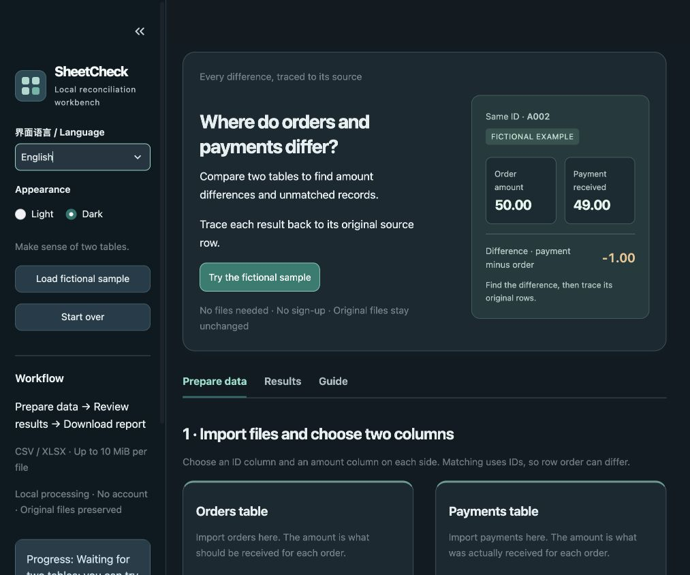

# v1.3.0 中英文界面与夜间模式验证

日期：2026-10-26（Asia/Singapore）。本轮增加侧栏语言与外观选项，沿用本地工作台、核对规则 `v1` 和报告格式 `m2-v1`。依赖锁、输入限制、安全配置和报告内容格式没有改变。

## 使用方式与范围

侧栏“界面语言 / Language”切换简体中文或 English；“外观 / Appearance”切换浅色或夜间。标题、操作、帮助、问题解释、结果表头、来源标签和空态随语言变化。文件名、工作表名、原始表头、业务编号、金额、问题码和已经填写的期间保留原值。Streamlit 自带上传、可访问性及工具栏文字可能仍使用英文。

切换偏好不重新核对；保留当前工作区、文件、解析设置、映射、确认、结果、筛选、分页、来源选择与已生成报告。“重新开始”与“加载虚构样例”仍撤销旧报告，但保留语言和外观偏好。偏好只在当前会话保存；刷新或新会话可能恢复默认值。

Excel 报告继续使用固定中文格式，界面切换不重写已生成的字节或改变规则。提示错误时保留固定错误码；无法翻译的安全错误说明使用固定英文通用说明，不回显异常中的原始业务数据。



样式与示意图只使用本地静态 CSS / HTML，没有外部字体、脚本或第三方组件。装饰 HTML 不接收业务原值。夜间样式覆盖卡片、输入框、下拉菜单、提示、来源、JSON 和报告区。当前 Streamlit 没有公开的会话级原生主题设置 API；数据表 canvas 在所选外观与原生主题不一致时使用局部颜色滤镜适配，不改变表格数值。该适配依赖本轮锁定的 Streamlit 版本，升级框架后需要重新检查。

## 验证记录

最终完整本地回归 **698 passed in 47.81s**；原有 684 项加 14 项语言、外观和控件同步测试，定向运行不重复计数。完整本地测试与环境记录见 [测试输出](v1.3-test-results.txt) 和 [环境快照](v1.3-environment.json)。43 个锁定 wheel 哈希、安装版本、`pip check`、本地配置和 55 个源码文件快照均通过。本轮复用 `.venv-v1.1`，以 `--no-index --no-cache-dir --no-build-isolation --no-deps` 更新可编辑应用，没有新建干净环境。

```sh
.venv-v1.1/bin/python -m pytest -q
.venv-v1.1/bin/python scripts/verify_install.py --wheelhouse outputs/m4/wheelhouse --output docs/v1.3-environment.json
```

新增偏好测试验证中英往返、部分输入与完整确认保留、工作区、205 条数据的筛选与分页、来源选择、结果对象、报告字节和延迟下载状态保留，以及重置、样例和替换输入继续撤销旧报告。特意使用与界面标签同名的中文业务字段，验证原始数据不被翻译。AppTest 的工作区切换通过真实会话值驱动；它不等同于浏览器视觉或文件下载验证。

浏览器实测发现语言改变后原生选项显示字符串没有自动同步，出现未选中的外观按钮并导致后续操作失败；现通过语言回调重发未改变的选择值修复，并增加下发控件值回归。修复后浏览器往返语言、工作区导航、来源及报告保留均通过。最终浏览器观察、截图和未覆盖项见 [浏览器记录](v1.3-browser-check.json)。

## 交付边界

- [M4 收尾](m4-closeout.json) 固定的 16 份历史证据已复核哈希，保持不变。历史成功下载、原生 Excel、断网、容量与性能记录仍保留原有版本和范围。
- GitHub 自动测试继续保持关闭，`docs/ci/github-actions.yml` 仍是非活动模板；没有新增 `.github/workflows` 文件，也不声明远程 CI 通过。
- 本轮没有重新执行干净安装、全量断网、容量、性能或原生 Excel 验收，不扩大其他浏览器、手机、Windows、Linux 或 Intel Mac 兼容声明。当前本机环境为 macOS 27.0.1 arm64 / CPython 3.12.14 / Streamlit 1.66.0。
- 没有点击浏览器报告下载、申请额外下载权限或补录下载录像。报告生成与回读成功不表示已下载保存。
- 本地包 `deliveries/SheetCheck-1.3.0.zip` 包含源码、文档、虚构样例、既有证据及本机依赖 wheel。成员、CRC、逐文件 SHA-256 和新目录解压校验见 [交付回执](v1.3-package-verification.json)；解压后没有再次运行应用测试，包校验只证明完整性。ZIP 与 wheel 不提交 Git。

最终完成范围见 [版本状态](v1.3-release-status.json)。
